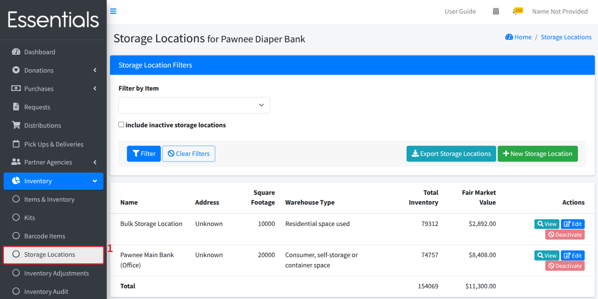
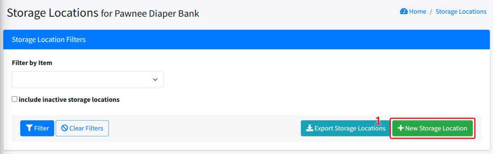
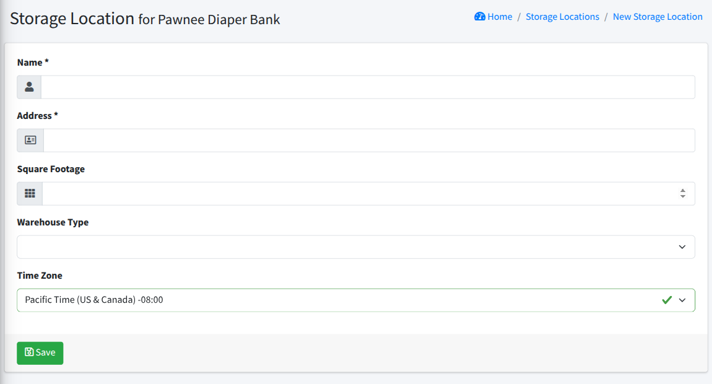
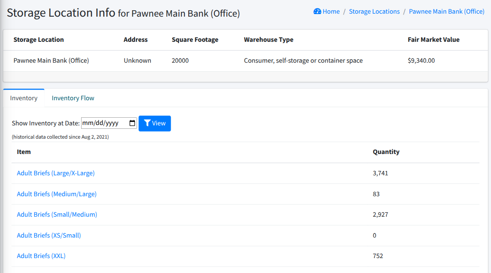
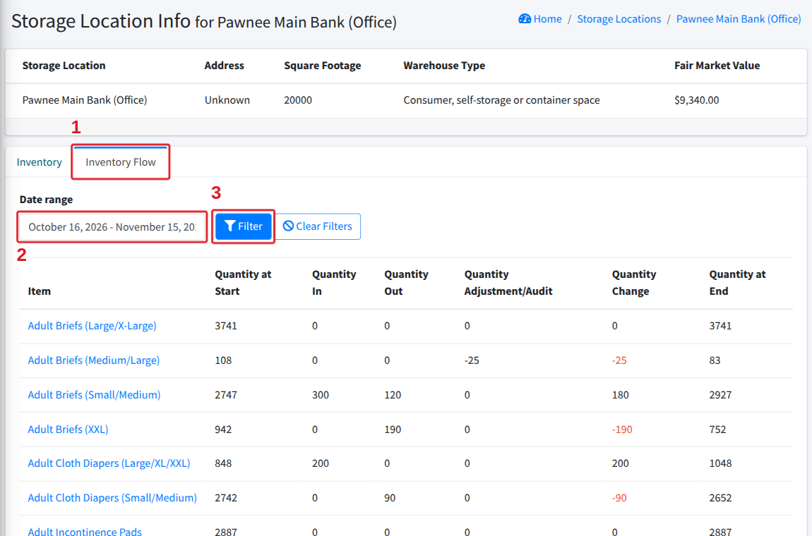
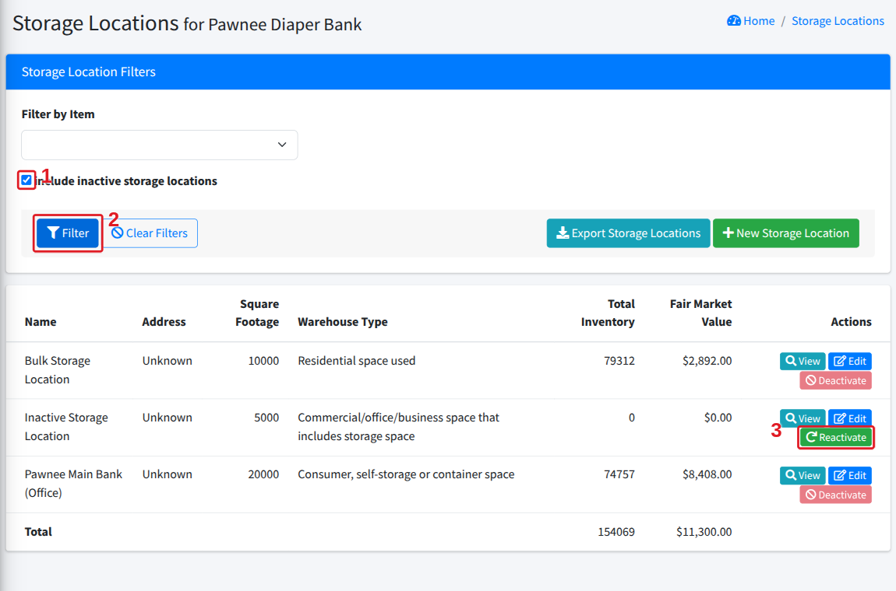

# Storage Locations

You need at least one Storage Location.   Each Donation and Purchase increases the inventory in a Storage Location,  and each distribution is made from the inventory in a Storage Location.  

## Storage Location summary page 
To get to the Storage Location summary page, click "Inventory", then "Storage Locations" in the left-hand menu

This shows all your Storage Locations, and allows you to navigate to view, edit, or possibly deactivate each one.

## Adding a Storage Location
To add a Storage Location,  click "New Storage Location" on the Storage Location summary page.

This brings up the New Storage Location page

- Name is mandatory, and is used in drop-downs throughout the system to indicate the Storage Location
- Address is also mandatory, but is information only.
- Square Footage is used in the annual survey report
- Warehouse Type is used in the annual survey report
- Time Zone is used with the pickup and deliveries calendar, particularly with allowing you to sync your pickups calendar with Google Calendar

## Storage location view
To view a Storage Location, click the "View" button beside it in the Storage Location summary page.
The view has two tabs:  Inventory and Inventory Flow

### Inventory 

Here you see the current levels of inventory for the chosen Storage Location.   You can see the inventory levels for past dates by choosing the date in "Show Inventory at Date" and clicking "View"
That shows the inventory at the beginning of the day.  The earliest date you can choose is when your inventory history begins in Human Essentials (shown under the date).

### Inventory Flow
This shows how the quantity of each item at the Storage Location changed over a date range.  Click the "Inventory Flow" tab (1), choose the range in "Date Range" (2), and click "Filter" (3).

For each item you see:
- Quantity at Start: how much was there at the start of the range
- Quantity In: what came in during the range ([Purchases](essentials_purchases.md), [Donations](essentials_donations.md), [Transfers](inventory_transfers.md) from other Storage Locations, and [Kit](inventory_kits.md) allocations and de-allocations that add inventory)
- Quantity Out: what went out during the range ([Distributions](essentials_distributions.md), [Transfers](inventory_transfers.md) to other Storage Locations, and [Kit](inventory_kits.md) allocations and de-allocations that remove inventory)
- Quantity Adjustment/Audit: the net change from [Adjustments](inventory_adjustments.md) and [Audits](inventory_audits.md) during the range
- Quantity Change: In, minus Out, plus Adjustment/Audit
- Quantity at End: how much was there at the end of the range

Each record is counted on the date it was entered into Human Essentials, not the date on the record itself (for example, a donation's issued date).  If a record is changed or deleted later, the change is counted on the date the record was first entered, so the numbers always reflect your records as they are now.  This means the Quantity at End for a past date can differ from what the Inventory tab shows for that date.

Human Essentials only keeps inventory history from a certain date, so a range can't start before then.  If you choose one that does, it starts from that date instead (noted under the table).

## Editing a Storage Location
You can edit your Storage Location (though it seems a very rare event), by clicking "Edit" beside the Storage Location in the Storage Location Summary Page.
The same fields are available as for [new Storage Locations](#adding-a-storage-location).  Make your updates and click save.

## Deactivating a Storage Location
You can only deactivate a Storage Location if the inventory for all its items is 0.
To deactivate the Storage Location, click "Deactivate" beside it on the Storage Location summary screen, then click "OK" to confirm.

## Reactivating a Storage Location
If you need to reactivate a Storage Location that was deactivated,  go to the Storage Locations summary screen (Inventory -- Storage Locations),  then click "include inactive Storage Locations", then Filter.
This will include inactive Storage Locations in the list.   Find the Storage Location you want to use again and click "Reactivate" beside it.

[Prior: Items](inventory_items.md)[Next: Audits ](inventory_audits.md)